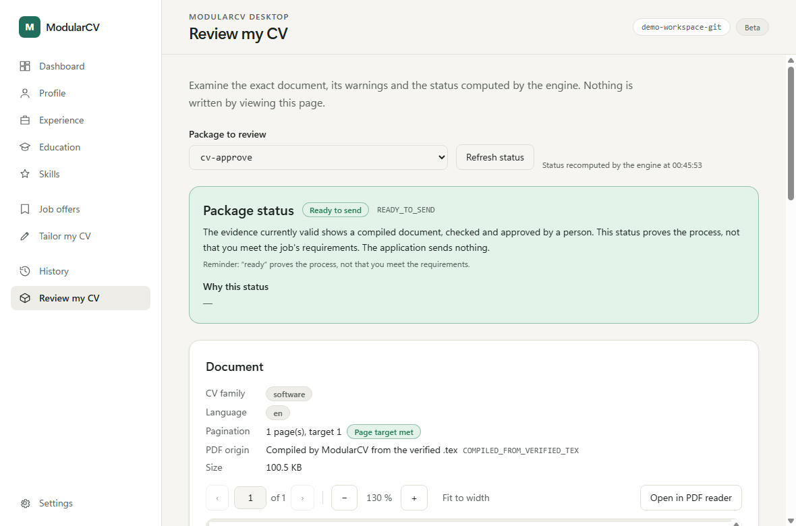

# ModularCV Desktop (beta)

Version `0.5.0-beta.1`. A Windows application for building CVs from your own confirmed facts, with a clear, checkable trail from the facts to
the PDF you send. Everything stays on your computer: no account, no network, no telemetry.



It is a window around the ModularCV engine and adds no rule of its own: reads, writes and verdicts go through the real engine, and the
engine's answer is shown as it is.

**What you can do:** check your fact base, browse and edit your profile, experiences, education, skills and job offers, see which of your facts
cover a job's requirements, build a tailoring plan, produce a `.tex` file and a PDF, freeze them in a package, then review the exact PDF and
record your own approval or refusal.

**Read before you rely on it:** an approval is your decision, saved in a local file that is **not signed**; `READY_TO_SEND` proves the process,
not the candidate. This is a beta, the installer is unsigned, and it was tested on a stripped-down Windows 11 image, not on a stock one. The installer is
prepared but **not yet published**.

| Guide | What it covers |
|---|---|
| [Installing](../docs/desktop/INSTALL.md) | Requirements, download, SHA-256 check, SmartScreen, WebView2 |
| [First start](../docs/desktop/FIRST_RUN.md) | A ten-minute tour with the fictional demonstration workspace |
| [Features](../docs/desktop/FEATURES.md) | What it does, what it will not do, privacy |
| [Statuses and approval](../docs/desktop/STATUSES.md) | `NEEDS_REVIEW`, `READY_TO_SEND`, `BLOCKED`; what an approval means |
| [Limits and known issues](../docs/desktop/KNOWN_ISSUES.md) | What was tested, what was not |
| [Uninstalling](../docs/desktop/UNINSTALL.md) | What is removed, what is kept, the "Delete app data" box |
| [Release notes](../docs/desktop/RELEASE_NOTES_0.5.0-beta.1.md) | This version |
| [En français](../docs/desktop/LISEZMOI.fr.md) | Installation, premier démarrage, statuts, désinstallation |

The rest of this page is for people who build or modify the application.

## For developers

Tauri 2, React, TypeScript, Vite, Tailwind CSS, Rust. Screens: dashboard (open a workspace, run `facts check`), profile, experiences,
education, skills, job offers, "Tailor my CV" (requirement matrix, tailoring plan, LaTeX/PDF generation, package creation), "History"
(packages and generated PDFs) and "Review my CV" (exact PDF preview, warnings, engine status).

## Dependencies

**To use the installed application (Windows 11 x64):** nothing to install. The installer carries its own Python engine (a PyInstaller
build of the unchanged `modularcv` engine and the Desktop adapter). WebView2 is part of Windows 11, so nothing is
downloaded there. The installer is configured with `webviewInstallMode: downloadBootstrapper`: only on a machine that lacks the WebView2
runtime does it fetch Microsoft's small bootstrapper (an internet connection is then needed during installation, and this is the one
prerequisite download that can happen; the application itself never downloads anything). The full runtime is not embedded. Optional,
never installed or downloaded by the
application, and reported in Settings > Environment diagnostics:

- **Git** (Git for Windows): needed to create verifiable packages (the engine checks a commit of your sources).
- **pdflatex** (MiKTeX or TeX Live): needed to produce PDFs and packages. Without it you can still browse, edit, analyse offers and
  produce `.tex` files.

**To develop or build:** Python 3.12 to 3.14, Rust (stable, MSVC) with the Visual Studio C++ build tools, Node.js and npm, Git. In
development the engine is the repository's Python (`MODULARCV_PYTHON` to choose the interpreter, `MODULARCV_ENGINE_DIR` for the engine
folder); a release build never falls back to a system Python.

## Third-party licence texts

`desktop/THIRD_PARTY_NOTICES.md` is the inventory of third-party components and `desktop/THIRD_PARTY_LICENSES.txt` holds their licence texts; both
are installed under `legal\`. The second file is generated: `python desktop/tools/build_third_party_licenses.py` (needs `cargo` and network access
for `cargo fetch`) rewrites it from the verbatim texts in `desktop/licenses/texts/` and from the licence files inside the Rust crates compiled into
`desktop.exe`; with `--check` it fails when the committed file is out of date, and `desktop/adapter/tests/test_third_party_licenses.py` checks it. Rerun it
whenever `Cargo.lock`, `package-lock.json`, the Python or PyInstaller version changes, and update the inventory by hand.

## Install and run (development)

```powershell
cd desktop
npm install
npm run tauri dev
```

## Building the installer

```powershell
powershell -File desktop\build-installer.ps1 [-Python <python 3.12-3.14>]
```

It builds the embedded engine (`build-sidecar.ps1`, PyInstaller **onedir**, tools in a private environment under
`%LOCALAPPDATA%\modularcv-build`, outside the repository), copies the fictional example workspace as a resource, builds the front end
and runs `tauri build --bundles nsis`. Output (git-ignored): `desktop\src-tauri\target\release\bundle\nsis\ModularCV Desktop_<version>_x64-setup.exe`.
The installer is per-user (no administrator rights), unsigned, and carries no workspace, secret or personal path. Tauri downloads the
NSIS tooling the first time it builds. The Desktop version (`tauri.conf.json`) is independent of the CLI tag `v0.2.0`.

Why onedir: on the reference machine a `facts check` took about 0.14 to 0.18 s with onedir against about 0.8 s with onefile (which
unpacks itself at every start), for 21 MB against 10 MB on disk. `build-sidecar.ps1 -Mode onefile` remains available.

The embedded engine (`engine\mcv-engine.exe` in the installation) accepts a closed set of modes only: `adapter`, `cli facts check --root`,
`diagnose`, `version`. The Rust side starts it without a shell, with per-operation timeouts, and keeps the closed operation list.
Workspaces are never inside the installation; uninstalling does not touch them. The uninstaller deletes the installed files one by one
and removes the install folder only if it is then empty (no recursive delete of the install folder). Its optional "Delete app data" box
is unticked by default; when ticked it removes only the application's own data folders (`org.modularcv.desktop` under the user's roaming
and local application data), which hold the settings and the fictional demo workspace. A workspace you keep elsewhere is never touched; do
not keep a real workspace inside those folders.

## Demo workspace

In the dashboard, "Demo workspace" copies the public `examples/workspace/` into
`%LOCALAPPDATA%\org.modularcv.desktop\demo-workspace` (outside the repository), then
"Check facts" runs the engine. "Demo with invalid facts" creates a separate
`demo-workspace-invalid` with a deliberately broken fact file. An existing folder is
reused as is, never overwritten. All data is fictional.

## Editing

- Open a workspace with the native folder picker (or "Manual entry"). Browse the profile and the
  facts; "Edit" switches a screen to a form, with an "Unsaved changes" indicator and a
  confirmation before leaving.
- Saving is always an explicit action. The adapter (`adapter/mcv_adapter.py`) re-validates with the
  engine, refuses anything invalid (nothing is written), refuses to overwrite a file changed elsewhere
  since it was read (reload, then retry), and replaces the file atomically. Only the edited fact's
  lines (facts.md) or the edited fields (profile.json) change; comments, other facts and unedited
  keys are kept. `profile.json` is re-indented (values identical).
- A fact is never confirmed implicitly: new facts start as "not confirmed"; confirming one, or changing
  a confirmed one, needs an explicit decision (checkbox) and the confirmation date you type.
- Nothing is committed to Git in your workspace. A modified but uncommitted source may not satisfy the
  provenance checks: commit it yourself.
- Not editable here: the language list, CV families, `resume.json` (shown read-only).

## Job offers and CV generation (step 3)

- **Offers** (`offers/*.json`, JobOffer-v1): list, add by hand, paste a description, import a compatible
  `.json` file, edit (conflict detection by source hash), delete (typed confirmation). Every write is validated
  by `joboffer.check_file()`; nothing is invented, no scraping, no network (the source URL is an optional note).
  An offer is untrusted data: it is shown as text and never interpreted.
- **Tailor my CV**: pick an offer, family and language; the engine builds the requirement matrix
  (DIRECT / ADJACENT / ABSENT / FORBIDDEN_TO_CLAIM, REQUIRED first, unmet REQUIRED always visible, ADJACENT never
  shown as demonstrated), then a `TailoringPlan-v1` (selected and omitted items with reasons). A plan is not a CV and
  not an approval. Plans are saved under `plans/`, never over an existing file (a new name is proposed).
- **Generation**: the plan is re-verified against the current sources, assembled (`ready_to_send: false`), rendered to
  `out/<name>.tex`, and to a PDF when `pdflatex` is installed (otherwise the app says so and keeps the `.tex`). An
  existing output is never overwritten; a distinct name is proposed. Preview, approval and readiness are step 4.
- **Provenance**: plan, assembly and rendering do not need a Git commit. Packaging does: if the workspace is not a Git
  repository, or sources are uncommitted, the app shows "unverified" with the reason; it never commits for you.
- **Concurrency**: new files are created exclusively; edits use a workspace lock file
  (`.modularcv-desktop.lock`), a hash check and an atomic replace. The lock is cooperative: it does not cover an external
  editor, so a very small window remains between the last hash check and `os.replace`.

## PDF preview, packages, history and review (step 4)

- **Preview**: the exact bytes of a PDF are read by the adapter (`pdf_read`), checked with the engine's PDF reader, hashed
  (SHA-256) and shown with pdf.js (pages, zoom, page count, hash; the browser side recomputes the hash on the received bytes
  and compares it with the engine's). Only two fixed locations of the active workspace can be read: a package's
  `applications/<name>/cv/resume.pdf` and `out/<name>.pdf`; names are validated, links are refused, nothing is loaded from a URL,
  and the front end has no file-system access. "Open in PDF reader" validates the document the same way, then hands only that
  file to Windows.
- **Packages**: "Tailor my CV", last step, runs the engine's `package create --compile`: the PDF of a package is always recompiled by
  the engine from the verified `.tex` (a PDF produced earlier, or supplied, is never reused, so no unverified origin is ever recorded).
  Creating a package is never an approval. It needs `pdflatex` and sources that match a Git commit of the workspace; otherwise nothing
  is created and the reason is shown. A package name is unique and never overwritten.
- **Review**: "Review my CV" shows the exact PDF, its hash, family, language, pagination verdict, unmet REQUIRED requirements, pending
  directives, warnings, the engine's limits and the status with its reasons. The status (`READY_TO_SEND`, `NEEDS_REVIEW`, `BLOCKED`)
  is recomputed by the engine (`package.status`) each time the page opens or is refreshed; nothing is computed or cached in React or
  Rust. Viewing writes nothing.
- **Approval** (graphical; a second human entry point next to the unchanged terminal command, no engine change): the review screen walks a person through: exact PDF displayed (fingerprint checked),
  every page displayed, two explicit confirmations, their name, the first 12 characters of the SHA-256 typed by hand, an explicit
  APPROVED or REJECTED, then a final confirmation dialog. Nothing is pre-ticked or pre-filled and nothing happens on opening or
  generating. The adapter (`package_approve`) re-reads the disk, refuses a stale context (changed PDF, sources, warnings or
  hash), refuses anything but a reviewable package and never overwrites a review, then records it through the engine's own
  `package.record_review()` and returns a fresh engine status, which is what the screen shows (`READY_TO_SEND` only if the engine
  says so). The terminal command `package approve` is unchanged and remains available. Design, guarantees and residual risks:
  `APPROVAL_PROPOSAL.md`. An approval is an unsigned JSON file; this does not prove who clicked.
- **History**: the packages present in the workspace (name, offer, family, language, PDF present or absent, freshly computed status).
  No date is shown (a package holds no reliable timestamp). An unreadable package is listed as such without hiding the others.
- **Git demo workspace (tests and demonstrations only)**: the dashboard button "Demo with Git (test)" copies the public example into
  `%LOCALAPPDATA%\org.modularcv.desktop\demo-workspace-git` and initialises an independent Git repository with one test commit, so a
  complete package can be tried. It runs only on that click, only on that new folder, never on a user's workspace, and the application
  makes no other commit anywhere.

## Tests

One command runs everything, including `desktop/adapter/tests` (which `pytest`'s `testpaths = ["tests"]` would
otherwise skip):

```powershell
powershell -File desktop\verify.ps1          # add -Python <path> to choose the interpreter, -SkipRust to skip cargo
# it also builds the embedded engine and tests the packaged executable (desktop/sidecar/tests) in a scrubbed environment
```

The steps, if you prefer to run them one by one:

```powershell
cd desktop
npm run typecheck
npm test                      # TypeScript/UI logic (vitest)
npm run build                 # frontend build
cd src-tauri
cargo test                    # bridge tests against the real Python engine (read, edit, errors)
cargo clippy --all-targets
```

Adapter tests (pytest, real engine, fictional workspace copied to a temporary folder; run from the
repository root with an interpreter that has pytest, not part of the default `tests/` run):

```powershell
python -m pytest desktop/adapter/tests
```

The Rust tests cover: valid workspace, invalid facts, missing workspace, empty
(unreadable) workspace, unavailable Python, missing engine, timeout and process kill,
exit-code/status mismatches, invalid JSON, and no-overwrite of the demo folder.

## Architecture

- `src-tauri/src/engine.rs`: `EngineLauncher` starts the interpreter without a shell, with a
  timeout, and parses the JSON into a typed `ValidationResult`. Replace it with a packaged
  sidecar later without touching React.
- `validate_workspace` accepts only the `facts_check` operation. The front end has no shell
  or process permission (capabilities: `core:default` and `dialog:allow-open`); structured reads and writes go through a closed list of adapter operations (reads, `save_fact`, `save_profile`, offers, matrix, plan, assemble, render) in `desktop/adapter/mcv_adapter.py`.
- Fail closed: success requires exit code 0, status `OK` and no error; any mismatch is shown as an error.
- No telemetry, no network, no logging of paths or fact text.

## Limitations

- `resume.json` is read-only. The approval is not signed (see above). Opening a PDF in the system reader may lock the file on Windows until it is closed.
- PDF generation needs `pdflatex` (MiKTeX or TeX Live) on `PATH`; without it only the `.tex` is produced.
- Development interpreter only (no sidecar, no installer, no distribution build).
- The native folder and file dialogs were exercised in the real Windows window (select, cancel, reopen after cancel, no panic);
  forcibly killing the process while a native dialog is open was not made a supported scenario.
- Engine start-up takes about 1.5 s per check on the reference machine.
- A valid fact base is not a human approval and never means "ready to send".
