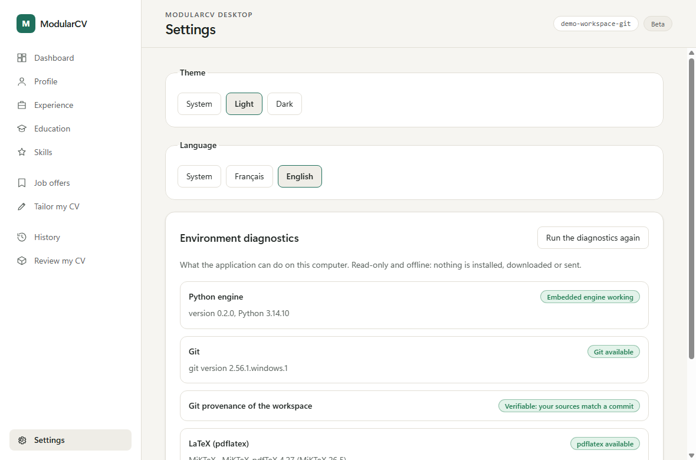
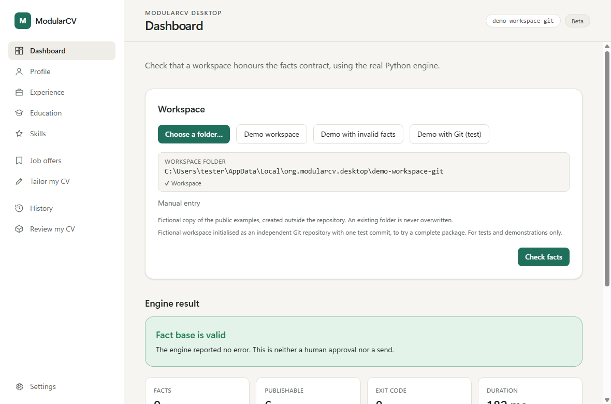
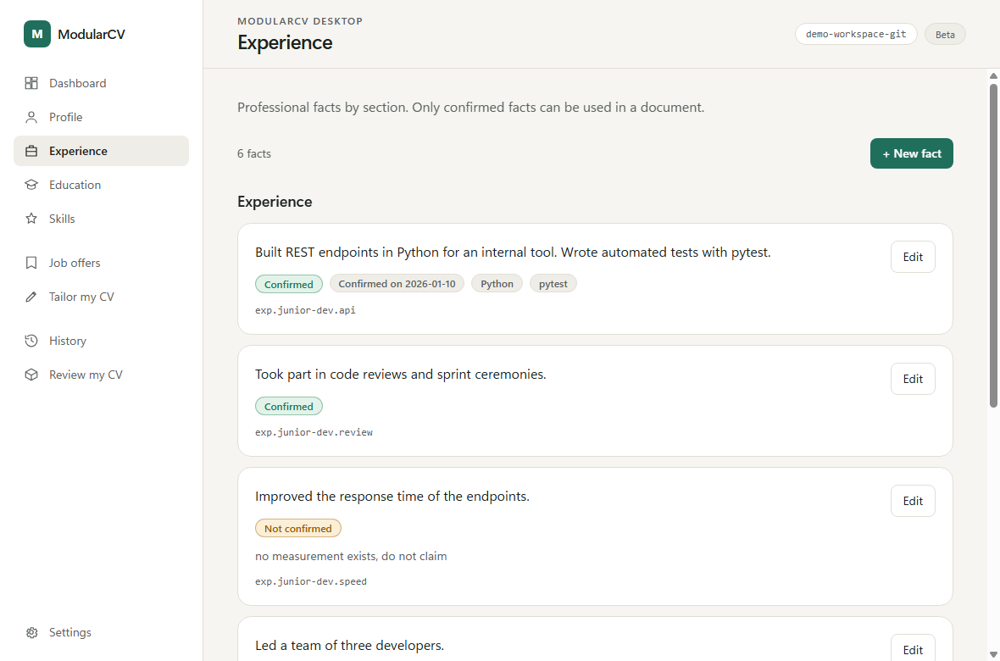
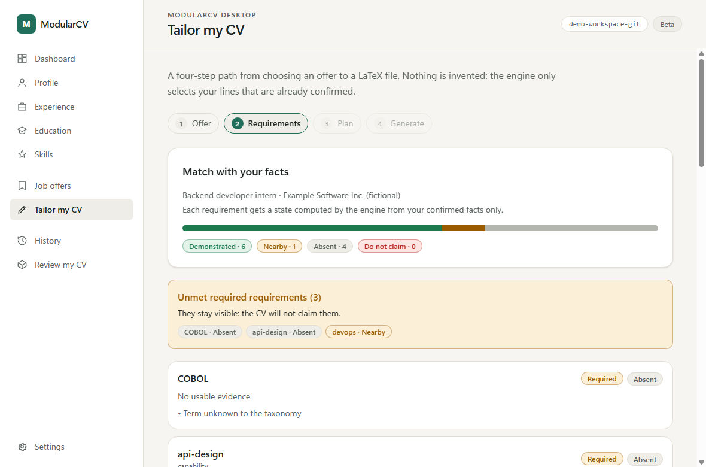
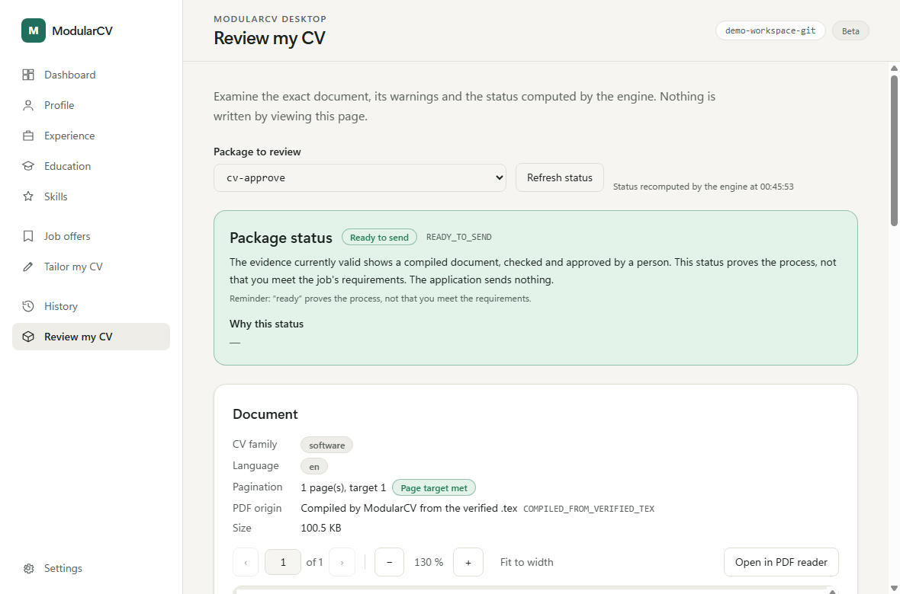

# First start

Français : [LISEZMOI.fr.md](LISEZMOI.fr.md)

This page walks you through the first ten minutes with a **fictional** workspace, so you can see every screen without touching your own data.
Install the application first ([INSTALL.md](INSTALL.md)).

## 1. Check your environment

Open **Settings** (language and theme are there too) and read **Environment diagnostics**. It shows, offline and read-only:

- the embedded engine and its version;
- whether Git is found, and whether the open folder is a Git repository;
- whether `pdflatex` is found, and whether PDF compilation can be attempted.

"Found" only means the program was found. It does not prove it is correctly configured (see [KNOWN_ISSUES.md](KNOWN_ISSUES.md)).

## 2. Open the demonstration workspace

On the dashboard, choose **Demo workspace**. The application copies a fictional example into
`%LOCALAPPDATA%\org.modularcv.desktop\demo-workspace`. Then choose **Check facts**: the engine reads the fact base and shows its verdict
(how many facts are confirmed, derived, not confirmed or withdrawn, and which can be published in a CV).

A second button creates a workspace with a deliberately broken fact file, to show how errors are reported. Nothing is ever overwritten:
an existing folder is reused as it is.

To work on your own CV, choose **Choose a folder** and pick your workspace (see the engine's
[WORKSPACE.md](../WORKSPACE.md) for its layout). Keep your real workspace **outside** the application's own data folders.

## 3. Look at, and edit, the data

The profile, experiences, education, skills and job offers screens read the workspace files through the engine. **Edit** turns a screen into
a form; unsaved changes are flagged and you are asked before you leave.

## 4. Adapt a CV to an offer

Open **Tailor my CV** and follow the steps:

1. Pick a job offer and choose **Analyse requirements**. The application shows the **requirement matrix**: each requirement is *Demonstrated*, *Nearby* or *Absent* against your confirmed facts (the engine's `DIRECT`, `ADJACENT`, `ABSENT`), and a requirement you must not claim is flagged. Unmet required requirements stay listed.
2. Build the **tailoring plan**.
3. Generate the **`.tex`** file. This works without any LaTeX installation.
4. With `pdflatex` available, compile a **PDF**.
5. With Git available and the workspace a Git repository, create a **package**.

The package freezes the sources, the plan, the `.tex` and the PDF together, and records the Git commit of your sources.

## 5. Review and approve

Open **Review my CV**. The screen shows the exact PDF the package refers to, with its fingerprint, the warnings, and the status computed by
the engine. To approve you must, explicitly: view every page, tick the two confirmations, type your name, type the first 12 characters of the
PDF fingerprint, choose **Approve** or **Refuse**, and confirm in a last dialog. Nothing is pre-ticked and nothing happens by itself.

Read [STATUSES.md](STATUSES.md) before relying on `READY_TO_SEND`. In short: **approval is your own decision, recorded in a local file that is
not signed.**

## 6. History

**History** lists packages and generated PDFs. Closing and reopening the application loses nothing: everything is in your workspace files.
