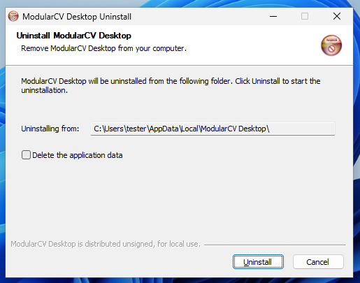
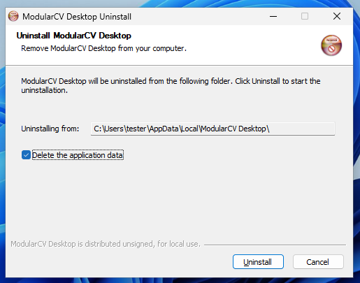

# Uninstalling ModularCV Desktop

Français : [LISEZMOI.fr.md](LISEZMOI.fr.md)

## How

Use **Settings > Apps > Installed apps > ModularCV Desktop > Uninstall**, or run `uninstall.exe` from
`%LOCALAPPDATA%\ModularCV Desktop`.

## What is removed

The program files of the application and its embedded engine, the Start-menu entry, and the entry in the list of installed apps. The uninstaller
deletes the files it installed one by one and removes the installation folder only if it is then empty. It never deletes a folder
recursively inside the installation.

## What is kept

- **Your workspaces.** They are never inside the installation folder, and the uninstaller never touches them wherever you keep them.
- **The application's own data**, by default (see the next section).
- Git, MiKTeX or TeX Live, and WebView2: the installer did not install Git or LaTeX, and WebView2 is shared with Windows.

## The "Delete app data" box

The uninstaller's first page has a check box, **Delete the application data**. It is **unticked by default**, and **Uninstall** is the default button, so
pressing Enter removes the program only.

- **Unticked (default):** the program is removed and every data folder stays, including the application's own data folders below.
- **Ticked:** the uninstaller also deletes these two folders, and only these two, with everything inside them:
  `%APPDATA%\org.modularcv.desktop` and `%LOCALAPPDATA%\org.modularcv.desktop`.

This was tested on a disposable installation in a virtual machine, with fictional files only. With the box unticked, the program, the Start-menu
entry and the installed-apps entry went and every marker file stayed. With the box ticked, both `org.modularcv.desktop` folders went, while a folder
named `org.modularcv.desktop.decoy` next to them, another folder in `%APPDATA%`, and a workspace in `Documents` were all left intact. The box has no
effect on a workspace stored anywhere else. If you do not tick the box, nothing is deleted behind your back; there is no way to delete data silently
(a silent uninstall, `uninstall.exe /S`, never ticks the box).

## Where the application keeps its own data

| Folder | Holds |
|---|---|
| `%LOCALAPPDATA%\org.modularcv.desktop` | The fictional demonstration workspaces (`demo-workspace`, `demo-workspace-git`, `demo-workspace-invalid`) and the web view's cache |
| `%APPDATA%\org.modularcv.desktop` | Settings, if any |

**Do not keep a real workspace inside these two folders.** Tick the box only if you are sure nothing you care about lives there.
